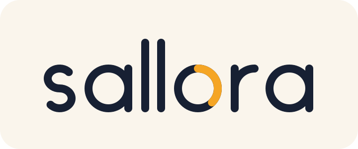
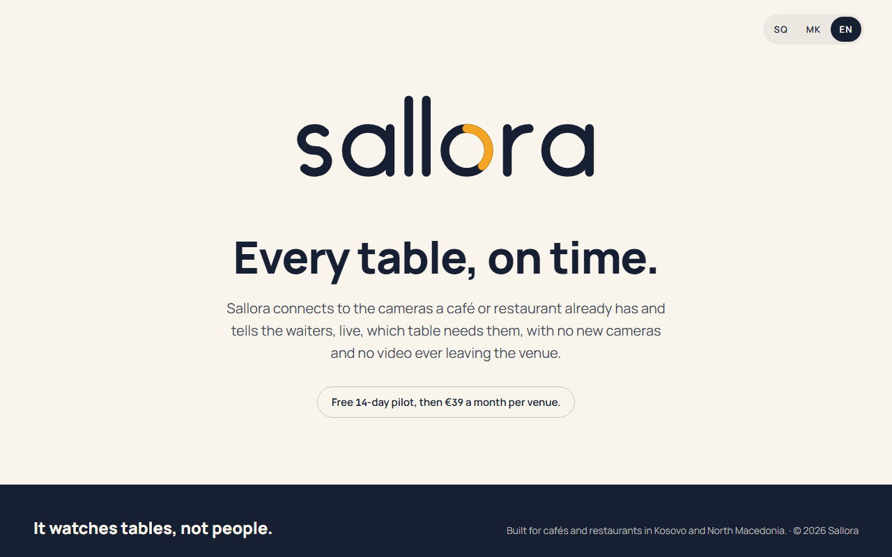

**Every table, on time.** · *Çdo tavolinë, në kohë.* · *Секоја маса, навреме.*

Sallora turns the security cameras a café or restaurant already has into a live table board. It tells waiters which table has waited too long or needs clearing, and every night it sends the owner a short report. Built for Kosovo and North Macedonia.

## Start the project in three commands

You need [Node.js](https://nodejs.org) 22.12 or newer (24 LTS recommended) and git.

```bash
git clone https://github.com/advansahiti70-oss/sallora.git
cd sallora
```

Then:

```bash
npm install          # 1. installs the front end and the back end
npm run db:migrate   # 2. creates backend/data/sallora.db with its 23 tables, and lists them
npm run dev          # 3. starts both
```

| Open | You should see |
|---|---|
| http://localhost:5173 | The landing page (switch SQ · MK · EN at the top right) |
| http://localhost:3000/health | `{"status":"ok", … "database":{"status":"ok","migrations":1,"tables":[…23 names]}}` |

The tables are also printed by step 2. To browse them, run `npm run db:studio` or open `backend/data/sallora.db` in any SQLite viewer. Stop the servers with Ctrl+C.



*The landing page. [PDF in English, Albanian and Macedonian](docs/hand-in/weekend-2-landing-page.pdf).*

## Hand-in: Weekend 2

- **Front end:** [`frontend/`](frontend/): React + Vite, one landing page in the brand colours and fonts, in Albanian, Macedonian and English.
- **Back end:** [`backend/`](backend/): Hono on Node.js, `GET /health`, SQLite through Drizzle. The models are in [`schema.ts`](backend/src/db/schema.ts) and the first migration is [`0000_initial.sql`](backend/drizzle/0000_initial.sql).
- **Docs:** [`docs/stack.md`](docs/stack.md) (the stack and why) and [`docs/data-model.md`](docs/data-model.md) (the diagram and every table).
- **Rules for Claude:** [`CLAUDE.md`](CLAUDE.md).

## Hand-in: Weekend 1

- **Product name:** Sallora
- **One-sentence pitch:** Sallora connects to the cameras a café or restaurant already has and tells the waiters, live, which table needs them, with no new cameras and no video ever leaving the venue.

## Docs

| File | What's inside |
|---|---|
| [`docs/business.md`](docs/business.md) | The problem, the big picture, the market (competitors, customer count for Kosovo and North Macedonia), Lean Canvas, price, monthly costs, the first 10 customers |
| [`docs/brand-book.md`](docs/brand-book.md) | Name and availability, tagline, logo, colours, fonts, tone of voice. Logo files are in [`docs/brand/`](docs/brand/). |
| [`docs/rules-and-flows.md`](docs/rules-and-flows.md) | Roles and permissions, 4 flows, 23 business rules, what v1 will NOT do |
| [`docs/stack.md`](docs/stack.md) | The technologies, one sentence on why for each, and how the parts fit |
| [`docs/data-model.md`](docs/data-model.md) | The data model: diagram, 23 tables in 5 groups, how they link, what we never store |
| [`docs/research/`](docs/research/) | A summary of the reel that inspired the idea, and the interview guide (SQ, MK, EN) |
| [`CLAUDE.md`](CLAUDE.md) | Instructions so that Claude Code builds from these docs |

## Status

- Weekend 1: business, brand and rules. ⚠️ Still to do: the two real interviews ([guide](docs/research/interview-guide.md)), pasted into [`docs/business.md` §1](docs/business.md#1-the-problem).
- Weekend 2: the frame (landing page, `/health`, the data model with its first migration). No features yet.
