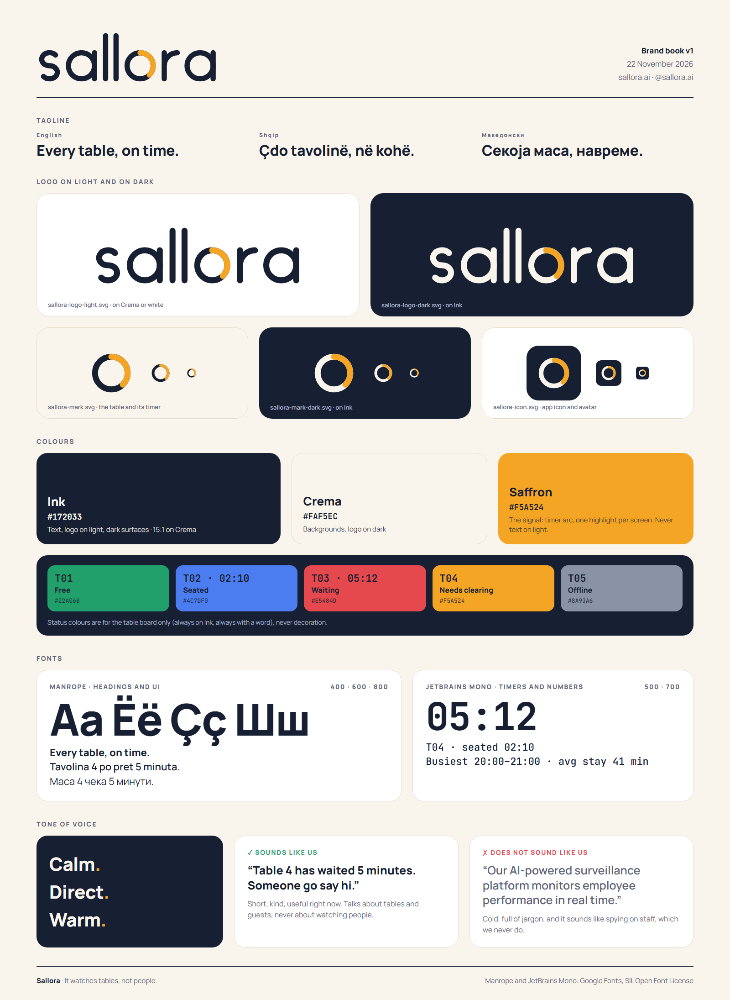
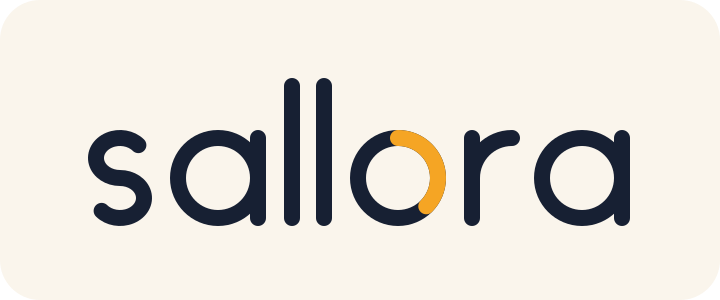
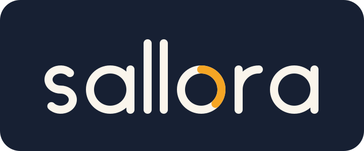

# Sallora brand book v1



> The board above is the one-page brand (source: [`brand/brand-board.html`](brand/brand-board.html)). This page explains the choices.

## Name: **Sallora**

- **Meaning:** *salla* (Albanian: hall, dining room) / *сала* (Macedonian: hall) + *ora* (Albanian: "the hour", the clock; Latin *hora*). Together: **the dining room, on time.** It also sounds like the Italian *allora*, which suits the macchiato café culture of Prishtina and Skopje.
- **How to say it:** sa-LLO-ra (SQ) · Салора (MK) · sah-LOR-ah (EN).
- **Why not a "table" name:** Tablo, Tabelo and Table Dot are all taken in restaurants or software, and "Tablo" sounds like Tableau.

### Availability (checked 22 Nov 2026)

| Asset | Status | How we checked |
|---|---|---|
| **sallora.ai** | ✅ not registered | .ai registry RDAP lookup (404) |
| **sallora.app** | ✅ not registered | Google Registry RDAP lookup (404) |
| sallora.com | ❌ registered | Verisign RDAP lookup |
| **Instagram @sallora.ai** | ✅ looks free ("Profile isn't available") | instagram.com, logged out |
| Instagram @sallora.app | ✅ looks free | same |
| Instagram @sallora | ❌ taken (inactive personal account) | same |

**Do this today:** buy **sallora.ai** (≈ $160 for the 2-year minimum) and create **@sallora.ai**. Availability can change at any time, and a logged-out check can't see reserved or banned usernames, so only creating the account proves it.
**Names we tried and dropped:** Tablo (all domains taken, sounds like Tableau), Tabelo (an existing bill-splitting app, tabelo.app), Hajde (all domains taken, "Hajde App" exists), Table Dot (a German lunch app and tabledot.com), Minuta (all domains taken).
**Watch:** *Salora* (one L) was a Finnish TV brand and is the name of an Indian electronics group. The spelling and industry are different, but run a trademark search at Kosovo's Industrial Property Agency and North Macedonia's State Office of Industrial Property before printing anything.

## Tagline

| | |
|---|---|
| 🇬🇧 English | **Every table, on time.** |
| 🇦🇱 Shqip | **Çdo tavolinë, në kohë.** |
| 🇲🇰 Македонски | **Секоја маса, навреме.** |

Second line, the privacy promise: **"It watches tables, not people."** · *"Shikon tavolinat, jo njerëzit."* · *"Ги гледа масите, не луѓето."*

## Logo

The logo is lowercase, round and monoline: friendly and calm. **The "o" is a round table seen from above, and the saffron arc is its timer**, the minutes a guest has been waiting. It is drawn from plain SVG strokes with no font file, so it looks the same everywhere.

| File | Use |
|---|---|
| [`brand/sallora-logo-light.svg`](brand/sallora-logo-light.svg) · [`.png`](brand/sallora-logo-light.png) | Wordmark on white or Crema |
| [`brand/sallora-logo-dark.svg`](brand/sallora-logo-dark.svg) · [`.png`](brand/sallora-logo-dark.png) | Wordmark on Ink |
| [`brand/sallora-mark.svg`](brand/sallora-mark.svg) | The symbol on light backgrounds (favicon, stickers, the door sign) |
| [`brand/sallora-mark-dark.svg`](brand/sallora-mark-dark.svg) | The symbol on dark backgrounds |
| [`brand/sallora-icon.svg`](brand/sallora-icon.svg) | App icon (rounded square) |
| [`brand/sallora-avatar-1080.png`](brand/sallora-avatar-1080.png) | Instagram and WhatsApp profile picture (the platform crops it to a circle) |
| [`brand/brand-board.html`](brand/brand-board.html) · [`.png`](brand/brand-board.png) | The one-page brand board |

| Logo on light | Logo on dark |
|---|---|
|  |  |

Ready-made panels for banners and previews: [`brand/sallora-logo-on-crema.svg`](brand/sallora-logo-on-crema.svg) and [`brand/sallora-logo-on-ink.svg`](brand/sallora-logo-on-ink.svg).

**Rules:**
- Leave clear space the height of the "o" all around the logo.
- Minimum width is 96 px for the wordmark and 20 px for the mark.
- Never recolour the saffron arc. It may animate (filling like a timer) inside the app, and that is the only animation allowed.
- Never add eyes, lenses or cameras.
- Never put the logo on a busy photo without an Ink or Crema panel.
- Never stretch or rotate it.

## Colours

| | Name | Hex | RGB | Use |
|---|---|---|---|---|
|  | **Ink** | `#172033` | 23, 32, 51 | Text, logo on light, dark surfaces, the table board background |
|  | **Crema** | `#FAF5EC` | 250, 245, 236 | Page backgrounds, logo on dark |
|  | **Saffron** | `#F5A524` | 245, 165, 36 | **The signal:** timer arc, one highlight per screen, buttons on Ink |

**Contrast:** Ink on Crema is 15.0:1 (AAA) and Saffron on Ink is 8.0:1 (AAA). Saffron on Crema is only 1.9:1, so **never use Saffron for text or thin lines on light backgrounds.**

**Status colours (product only, for the live table board):**
Free `#22A06B` · Seated `#4C7DF0` · Waiting `#E5484D` · Needs clearing `#F5A524` · Offline `#8A93A6`.
They always sit on Ink (all reach at least 4:1 there) and always come with a word and a timer, because some staff are colour-blind. Never use them for decoration.

```css
:root {
  --ink: #172033;
  --crema: #FAF5EC;
  --saffron: #F5A524;
  --status-free: #22A06B;
  --status-seated: #4C7DF0;
  --status-waiting: #E5484D;
  --status-clear: #F5A524;
  --status-offline: #8A93A6;
  --font-sans: "Manrope", "Segoe UI", system-ui, sans-serif;
  --font-mono: "JetBrains Mono", Consolas, monospace;
}
```

## Fonts

| Font | Used for | Weights | Why |
|---|---|---|---|
| **[Manrope](https://fonts.google.com/specimen/Manrope)** | Headings, UI, reports | 400 · 600 · 800 | Friendly geometric shapes that match the logo; full Albanian (ë, ç) and Macedonian Cyrillic; free (SIL OFL) |
| **[JetBrains Mono](https://fonts.google.com/specimen/JetBrains+Mono)** | Timers, table numbers, prices | 500 · 700 | Every digit is the same width, so "05:12" doesn't jump while it counts; has Cyrillic; free (SIL OFL) |

```html
<link href="https://fonts.googleapis.com/css2?family=JetBrains+Mono:wght@500;700&family=Manrope:wght@400;600;800&display=swap" rel="stylesheet">
```

## Tone of voice: **Calm · Direct · Warm**

- **Calm:** no alarms, no capital letters, no blame. A 10-minute wait is a fact, not a scandal.
- **Direct:** name the table, the time and what to do. Short sentences, numbers instead of adjectives.
- **Warm:** we're on the waiter's side. We talk about guests and tables, never about watching people.

| ✅ Sounds like us | ❌ Does not sound like us |
|---|---|
| **"Table 4 has waited 5 minutes. Someone go say hi."** | "Our AI-powered surveillance platform monitors employee performance in real time." |
| "Friday: busiest 20:00–21:00. 14 alerts, answered in 1 min 40 s on average. Nice work, team." | "WARNING: Service KPI breach detected. Staff productivity below threshold." |

**The alert in our three languages:**
- EN: *Table 4 has waited 5 minutes.*
- SQ: *Tavolina 4 po pret 5 minuta.*
- MK: *Маса 4 чека 5 минути.*

| Words we use | Words we avoid |
|---|---|
| table board, tables, guests, team, alert, "needs you", on time | surveillance, monitoring staff, tracking people, faces, KPI, productivity, AI-powered |
