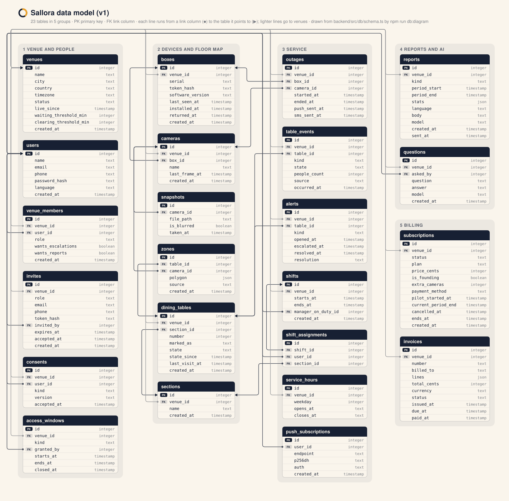

# Sallora: the data model (v1)

*Click the picture to open it full size.*

- **Source of truth:** [`backend/src/db/schema.ts`](../backend/src/db/schema.ts). Every table and rule is there, with the rule IDs in comments.
- **The picture** ([`data-model.svg`](data-model.svg)) and **the DBML** ([`data-model.dbml`](data-model.dbml)) are drawn from that file by `npm run db:diagram`, so they always match the code. To see the model on [dbdiagram.io](https://dbdiagram.io), paste the DBML into its editor and arrange the tables however you like.
- **First migration:** [`backend/drizzle/0000_initial.sql`](../backend/drizzle/0000_initial.sql) creates all 23 tables in `backend/data/sallora.db` when you run `npm run db:migrate`.

## What Sallora never stores (privacy by design)

- **No video, no recordings, no frames** (BR-01, BR-03). The only image is the setup snapshot, and even that is just a file path in `snapshots`, deleted at go-live unless the owner keeps a blurred copy (BR-04).
- **No guests and no faces** (BR-02). Guests are never rows anywhere. `table_events.people_count` is a number, not people.
- **No camera stream addresses or passwords in the cloud.** They stay on the Sallora Box in the venue.
- **No "who answered"** on alerts or taps (BR-06), so no report can rank waiters.
- **No secrets in plain text.** Invite links and box keys are stored only as hashes.

## The 23 tables

### 1. Venue and people

| Table | What it stores | Rules |
|---|---|---|
| `venues` | One café or restaurant: name, city, country (XK or MK), time zone, setup or live, waiting threshold (default 5 min) and clearing threshold (default 3 min) | BR-05, BR-09, BR-10, BR-17 |
| `users` | A person who signs in, staff only: name, email or phone, password hash, language (sq, mk, en) | BR-02, BR-15 |
| `venue_members` | A user's role at a venue (owner, manager, waiter, installer, support) and their opt-ins for escalations and reports | Roles, Flow 2.5, Flow 3.4 |
| `invites` | Invite links sent by email or phone, with role and expiry | Flow 1.1, 1.8 |
| `consents` | The terms, the data-processing agreement and the **privacy checklist**, with version, who and when. No venue goes live without the checklist. | BR-05, Flow 1.2, 1.9 |
| `access_windows` | The installer's setup window (at most 72 h) and the support pass (at most 24 h) | Flow 1.3, Roles |

### 2. Devices and floor map

| Table | What it stores | Rules |
|---|---|---|
| `boxes` | The Sallora Box: serial, key hash, software version, last seen, returned | BR-01, BR-19, BR-23 |
| `cameras` | A camera: name, which box reads it, last frame seen | BR-01, BR-17, BR-23 |
| `snapshots` | The one setup still per camera (file path, blurred or not) | BR-04 |
| `zones` | The outline of a table on a camera image (points from 0 to 1), proposed by Claude or drawn by hand | Flow 1.6 |
| `dining_tables` | A numbered table (T04): section, current state and since when, last visit, Reserved or Closed | BR-07, BR-08, BR-10, BR-13, BR-17 |
| `sections` | A group of tables one waiter covers, e.g. "Terrace" | BR-11 |

### 3. Service

| Table | What it stores | Rules |
|---|---|---|
| `service_hours` | Opening hours per weekday; closing after midnight is allowed | BR-13, BR-15 |
| `shifts` | A working period and its manager on duty | BR-12 |
| `shift_assignments` | Who works the shift and which section they cover | BR-11 |
| `table_events` | What happened at a table: a state change or a visit, people count, from the box or a tap. Kept 13 months. | BR-01, BR-06, BR-07, BR-08, BR-21 |
| `alerts` | Waiting and needs-clearing alerts: opened, escalated, resolved, and how (tap, seen or expired), never who | BR-06, BR-09 to BR-14 |
| `outages` | A box or camera offline for more than 2 minutes: one push, then one SMS after 10 minutes | BR-23 |
| `push_subscriptions` | The phones and browsers that receive push alerts | BR-14, Flow 1.8 |

### 4. Reports and AI

| Table | What it stores | Rules |
|---|---|---|
| `reports` | Nightly, weekly, pilot and monthly reports: venue and table numbers only, Claude's text, language, model | BR-06, BR-15, BR-16, BR-18, BR-21 |
| `questions` | Questions from the owner or a manager, and Claude's answers from this venue's numbers | Flow 3.5, BR-16 |

### 5. Billing

| Table | What it stores | Rules |
|---|---|---|
| `subscriptions` | One per venue: pilot, active, past due, suspended or cancelled; plan, price, extra cameras, founding venue | BR-17 to BR-20, BR-22 |
| `invoices` | Monthly or yearly fees, the setup fee, extra cameras, the €150 box charge; kept even after the venue is deleted | BR-19, BR-20, BR-22 |

## How the tables link

- **Everything belongs to a venue.** 17 tables carry a `venue_id`. Deleting a venue (30 days after it cancels, BR-22) deletes their rows too, with two exceptions where only the link is cleared: `boxes`, because the box is our hardware on loan, and `invoices`, which accounting law requires us to keep (`billed_to` keeps the business name).
- **People:** `users` and `venues` meet in `venue_members`, one role per person per venue.
- **Floor map:** a box reads cameras. A camera has snapshots and zones. A dining table has a zone on 1 or 2 cameras and belongs to at most one section.
- **Service:** `table_events` and `alerts` belong to a dining table. An outage points at a box or a camera. A shift has a manager on duty and assignments (user → section).
- **One to one:** a venue has exactly one subscription.
- **Links that can go empty** (`set null`): when a user, box or section is removed, the history stays and only the link is cleared, e.g. `invites.invited_by`, `cameras.box_id`.

## Conventions

- **ids** are integers. **Timestamps** are integer seconds since 1970 in UTC (Date objects in code). Opening hours are local "HH:MM" text, read with `venues.timezone`.
- **Allowed values** are text columns with a CHECK constraint, because SQLite has no enum type, e.g. `dining_tables.state` is one of `free`, `seated`, `waiting`, `needs_clearing`, `offline`.
- **Simple rules live in the database too:** the BR-09 and BR-10 ranges, the 72 h and 24 h access windows, "a state event needs a state". [`backend/test/data-model.test.ts`](../backend/test/data-model.test.ts) checks them.
- **Live state and history:** each table's current state sits on `dining_tables` for the live board, and the full history is in `table_events`.

## How to change the model

1. Edit `backend/src/db/schema.ts`, citing the rule ID.
2. `npm run db:generate -- --name what-changed` writes the next SQL file into `backend/drizzle/`.
3. `npm run db:migrate` applies it.
4. `npm run db:diagram` redraws the picture and the DBML.
5. Update this page. Never edit a migration that has already been applied.
