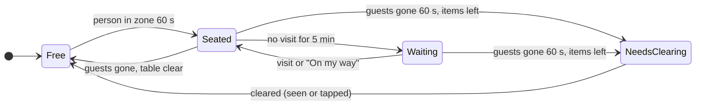

# Sallora: users, flows and business rules (v1)

> **This file is the source of truth for product logic.** If the code and this file disagree, update this file first, then the code.

## Words we use

| Word | Meaning |
|---|---|
| **Venue** | One café or restaurant location. One subscription per venue. |
| **Sallora Box** | The small computer we install at the venue. It reads the camera streams **locally**. |
| **Camera** | An existing CCTV camera (an RTSP stream from the recorder (NVR/DVR) or from the camera itself). |
| **Zone** | The outline of one table on one camera image, drawn at setup. |
| **Table** | A numbered table (T01, T02…). A table can have zones on 1–2 cameras. |
| **Section** | The group of tables one waiter covers during a shift. |
| **Service hours** | Opening hours set by the owner. Alerts only fire inside them. |
| **Visit** | A staff member standing at the table for at least 5 seconds, or a tap on **On my way** or **Served**. |

### Table states



| State | Colour | Meaning |
|---|---|---|
| **Free** | green `#22A06B` | Nobody at the table, and it looks clear |
| **Seated** | blue `#4C7DF0` | Guests at the table; the timer counts from the last visit |
| **Waiting** | red `#E5484D` | Seated, and nobody has visited for the threshold (default 5 min). An alert is sent. |
| **Needs clearing** | saffron `#F5A524` | Guests left, but cups, plates or glasses are still on the table |
| **Offline** | grey `#8A93A6` | The box or camera is down. The table's state is unknown and no alerts are sent. Any state can become Offline. |

---

## Users and roles

| Role | Who | In one line |
|---|---|---|
| **Owner** | Pays; usually one per venue | Can do everything: billing, cameras, table map, staff, rules, reports, export and delete data |
| **Manager** | Shift lead or head waiter | Runs the floor: sees the whole board, assigns sections, changes thresholds, reads reports, gets escalations |
| **Waiter** | Floor staff | Sees the board, gets alerts for their own section, taps *On my way*, *Served* or *Cleared* |
| **Installer** | The Sallora team or a partner installer | Connects the box and cameras and draws the zones, **only during a setup window the owner opens** (max 72 h) |
| **Sallora support** | Our team | Box health, logs and updates. **No camera images** unless the owner grants a 24-hour support pass. |
| *Guests* | Not users | Never identified and never tracked between visits; informed by the sign at the door |

| Action | Owner | Manager | Waiter | Installer | Support |
|---|:-:|:-:|:-:|:-:|:-:|
| Billing, change plan, cancel | ✅ | – | – | – | – |
| Invite or remove staff, set roles | ✅ | ✅ (waiters only) | – | – | – |
| Add cameras, draw or edit table zones | ✅ | ✅ | – | ✅ (setup window) | – |
| Set thresholds and service hours | ✅ | ✅ | – | – | – |
| Assign sections for a shift | ✅ | ✅ | – | – | – |
| See the live board | ✅ | ✅ | ✅ | ✅ (setup window) | – |
| Receive table alerts | optional | escalations | own section | – | – |
| Tap *On my way*, *Served*, *Cleared* | ✅ | ✅ | ✅ | – | – |
| Read the nightly report and history | ✅ | ✅ | – | – | – |
| Ask questions about the numbers (AI) | ✅ | ✅ | – | – | – |
| See a camera snapshot | ✅ (setup) | ✅ (setup) | ❌ | ✅ (setup) | 24-hour pass only |
| Export or delete venue data | ✅ | – | – | – | – |
| Box health and updates | 👁 view | 👁 view | – | ✅ | ✅ |

---

## Flow 1: set up a venue (from "yes" to live)

1. The owner agrees to a pilot (in person, or through the "DEMO" form). We create the venue, and the owner gets an invite link by email or WhatsApp, sets a password and picks a language (SQ, MK or EN).
2. The owner accepts the terms and the **data-processing agreement**: Sallora processes data on the venue's behalf.
3. The owner opens a **setup window** (72 h) for the installer.
4. The installer plugs the Sallora Box into the venue's network and power. The box shows as **Online** in the app.
5. The installer adds the cameras. The box finds the recorder or cameras on the network, the installer enters the stream login the owner gives them, and the box tests each stream (at least 1 frame per second).
6. The box takes **one still snapshot per camera**. Claude proposes table outlines and numbers, the installer fixes them by dragging, and the owner confirms the map. Every table must be visible on at least one camera.
7. The owner sets the service hours, the waiting threshold (default 5 min) and the clearing threshold (default 3 min).
8. The owner or manager invites staff by phone number or email and assigns sections. Waiters add the web app to their phone and allow notifications.
9. **Privacy checklist (blocking).** The owner confirms that (a) the Sallora sign is up at every entrance, (b) employees received written notice, and (c) no camera covers toilets or changing rooms. **Only then can the venue go live.**
10. **Test run.** The installer sits at two tables. The board shows *Seated*, then *Waiting* after a 1-minute test threshold. A waiter's phone buzzes, the waiter taps *On my way*, and the test is done.
11. **Go live.** The setup snapshots are deleted, unless the owner chooses to keep a blurred copy for redrawing zones later.
12. **Pilot:** days 1–3 are *silent* (we only measure), and days 4–14 have alerts on. On day 14 the owner gets the **before/after report** and a link to continue (Flow 4).

## Flow 2: live service (a guest sits, waits, is served and leaves)

```mermaid
sequenceDiagram
    participant Cam as Camera
    participant Box as Sallora Box (in the venue)
    participant Cloud as Sallora cloud
    participant W as Waiter (section)
    participant M as Manager
    Cam->>Box: video frames (never leave the venue)
    Box->>Cloud: T04 Seated 20:14:05 (event only)
    Note over Box: no visit for 5 min
    Box->>Cloud: T04 Waiting 20:19:05
    Cloud->>W: "Table 4 has waited 5 minutes."
    alt answered within 2 min
        W->>Cloud: On my way
    else nobody answers
        Cloud->>M: "Table 4 has waited 7 minutes. Nobody answered."
    end
    Box->>Cloud: T04 visit 20:20:10 (timer restarts)
```

1. A guest sits at T04. The box sees a person in T04's zone for 60 seconds in a row, so **T04 → Seated** and the timer starts at 00:00.
2. A waiter stands at T04 for at least 5 seconds, or taps **Served**. That counts as a visit, and the timer restarts from 00:00.
3. If there is no visit before the threshold (default 5:00), **T04 → Waiting**. A push alert goes to the waiter whose section includes T04, in their language: *"Table 4 has waited 5 minutes."*
4. The waiter taps **On my way**. The alert closes for everyone, and T04 goes back to Seated.
5. If nobody answers within **2 minutes**, the alert **escalates** to the manager on duty (and to the owner, if they opted in). If no section is assigned, the alert goes to every waiter on shift.
6. When everyone has left the zone for 60 seconds: if cups, plates or glasses are still detected, **T04 → Needs clearing** and the section's waiter gets an alert after 3 minutes (*"Table 4 needs clearing."*). If the table looks clear, **T04 → Free**.
7. A waiter clears the table. The box sees it is clear (or someone taps **Cleared**), and **T04 → Free**.
8. **"Free next" list:** the board ranks seated tables by how likely they are to free up soon (time seated compared with the venue's average stay at that hour). The host can tell people at the door "about 10 minutes".
9. If the box or a camera is **offline for more than 2 minutes** during service hours, the affected tables show *Offline*, no alerts are sent for them, and the owner and manager get **one** notification (push first, SMS if it is still offline after 10 minutes).

## Flow 3: the nightly report and questions

1. During service the box sends table events (never images) to the cloud as they happen.
2. **30 minutes after closing**, the cloud computes the day: guests and busy tables per hour, the busiest hour, average party size, average stay, Waiting alerts, average response time, average time to clear, and tables that waited more than 10 minutes.
3. **Claude writes a short report** in the owner's language (≈ 150 words and the 4 key numbers), compared with the same weekday last week.
4. The report goes to the owner (and to managers who opted in) by email and in the app. A share button sends it to WhatsApp or Viber.
5. The owner can **ask questions** in the app ("Which hour on Saturdays needs another waiter?"). Claude answers only from this venue's numbers and says so when there isn't enough data.
6. **Every Monday** there is a weekly summary with one concrete suggestion (e.g. "Saturdays 20:00–22:00 had 3× more alerts. Try one more waiter.").

## Flow 4: pilot → pay → cancel

1. On day 12 of the pilot we send a reminder. On day 14 the owner gets the pilot report and the offer.
2. The owner picks **monthly (€39)** or **yearly (€390)** and pays by card online or by **bank-transfer invoice** (common for businesses in Kosovo and North Macedonia).
3. The setup fee (€149) is invoiced with the first month and waived for founding venues.
4. The subscription renews monthly on the same date, with the invoice sent by email.
5. **Failed payment:** 7 days of grace with reminders. On day 8 alerts pause (the board still works). On day 21 the account is suspended.
6. **Cancel any time** in the app (owner only). Service runs to the end of the paid period, the box is picked up or returned within 14 days, and venue data is deleted 30 days after the end date. The owner can export it first.

---

## Business rules (in plain words)

**Privacy (non-negotiable)**
- **BR-01** Video never leaves the venue. The box analyses frames in memory and sends only **table events** (table, state, time, number of people) to the cloud.
- **BR-02** No face recognition, no identifying or re-identifying people, no age or gender guesses, no audio. Ever.
- **BR-03** No recordings. Frames are discarded within seconds. The venue's own CCTV recorder keeps working as before; Sallora doesn't touch it.
- **BR-04** The only stored image is the **setup snapshot** per camera, used to draw zones. Only the owner, manager and installer can see it, and it is deleted after setup unless the owner keeps a blurred copy.
- **BR-05** A venue cannot go live until the owner confirms: a sign at every entrance, written notice to employees, and no cameras in toilets or changing rooms.
- **BR-06** No per-waiter scores, rankings or "who was slowest" reports. Reports are about **tables and the venue**, never individual staff.

**Tables and timers**
- **BR-07** A table becomes *Seated* only after a person has been in its zone for **60 seconds in a row**, so people walking past don't count.
- **BR-08** A *visit* is someone standing at the table's edge for **5 seconds or more**, or a tap on *On my way* or *Served*. Every visit restarts that table's timer.
- **BR-09** The waiting threshold defaults to **5 minutes**. The owner or manager can set it from **2 to 15 minutes**. In v1 one value applies to every table in the venue.
- **BR-10** *Needs clearing* means the guests have been gone 60 seconds or more and items are still on the table. Its alert comes after **3 minutes** (adjustable from 1 to 10).

**Alerts**
- **BR-11** An alert goes to the waiter whose section includes the table. If there is no section, it goes to every waiter on shift.
- **BR-12** An alert not answered within **2 minutes** escalates to the manager on duty. A table never sends more than **one alert every 5 minutes**.
- **BR-13** No alerts outside service hours, for tables marked *Reserved* or *Closed*, or for tables that are *Offline*.
- **BR-14** A waiter gets at most **one push every 30 seconds**. Alerts that arrive together are grouped ("Tables 4 and 7 need you").

**Reports and AI**
- **BR-15** The nightly report is sent **30 minutes after closing**, in the owner's language, and uses only that venue's numbers.
- **BR-16** Claude never sees camera images during service. It sees only the setup snapshots, and never personal data about staff or guests.

**Billing**
- **BR-17** One subscription covers one venue with up to **4 cameras and 40 tables**. Each extra camera is **€9/month**.
- **BR-18** **The pilot is 14 days, free, with no card needed.** Days 1–3 are silent (measuring only) and days 4–14 have alerts on, which gives the before/after report.
- **BR-19** You can cancel any time, effective at the end of the paid month. Partial months are not refunded. The box comes back within **14 days**, or **€150** is charged.
- **BR-20** After a failed payment there are 7 days of grace. Alerts pause on day 8 and the account is suspended on day 21.

**Data and devices**
- **BR-21** Table events are kept for **13 months** (to compare with last year). After that, only monthly totals remain.
- **BR-22** After cancellation all venue data is **deleted after 30 days**. The owner can export it (CSV) before then.
- **BR-23** If the box or a camera is offline for **more than 2 minutes** during service hours, its tables show *Offline* and the owner and manager get one notification.

---

## What version one will NOT do

- ❌ No face recognition, no identifying guests or staff, no age or gender estimates, no audio.
- ❌ No video recording, playback or cloud video storage. The venue's own recorder does that.
- ❌ No theft, fight, fall or other security detection.
- ❌ No per-waiter performance scores or rankings.
- ❌ No reservations, online booking, or waitlist messages to guests.
- ❌ No POS integration (orders, bills, revenue). That is planned for v2.
- ❌ No kitchen, bar or delivery monitoring.
- ❌ No counting of people waiting at the door. That is planned for v2, with a door camera.
- ❌ No native iOS or Android app. v1 is a web app (PWA) with push notifications.
- ❌ No multi-venue dashboard. Each venue stands alone in v1.
- ❌ No promise for terraces at night or for cameras that see tables from very far away. We check coverage at setup and say no when it won't work.
- ❌ We don't sell cameras. Installer partners do.
- ❌ No languages other than Albanian, Macedonian and English.

## Open questions (answer them after the interviews)

1. Is 5 minutes the right default? Cafés may want 3 and restaurants 7.
2. Do waiters want alerts on their phone, a smartwatch, or a tablet at the bar?
3. Will owners accept "no per-waiter scores"? If many insist, what can we show without spying (e.g. section totals)?
4. Card or bank transfer? Many businesses here pay by invoice.
5. How many venues need their summer terrace covered?
