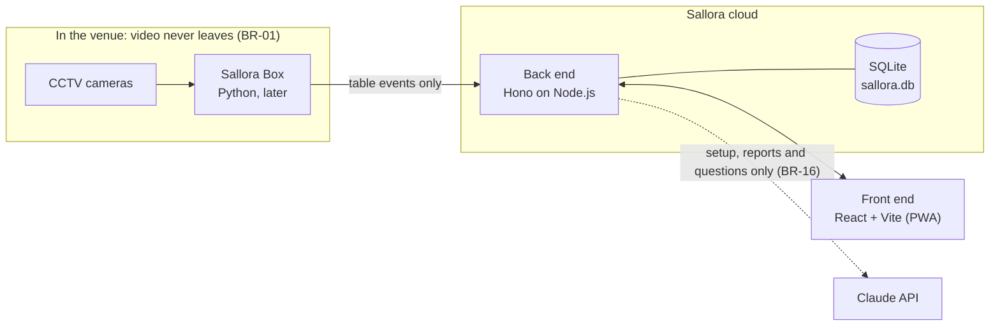

# Sallora: the stack

| Part | Technology | Why |
|---|---|---|
| **Front end** | **React 19 + Vite 8 + TypeScript**, in `frontend/` (official `create-vite` `react-ts` template) | The live table board, the zone editor and the reports are interactive screens that will become an installable web app (PWA) on staff phones, and React with Vite is the most widely documented way to build them. |
| **Back end** | **Hono 4 on Node.js 24 + TypeScript**, in `backend/` (official `create-hono` `nodejs` template) | It uses the same language as the front end, so table states, API types and the SQ/MK/EN strings can be shared, and one `npm install` sets up the whole repository. |
| **Database** | **SQLite**, one file at `backend/data/sallora.db` (never committed), through **Drizzle ORM + better-sqlite3** | The models are plain TypeScript, Drizzle writes every migration as a readable SQL file, and better-sqlite3 ships ready-made binaries, so nothing has to compile on a classmate's laptop. |

## Smaller choices

| | Choice | Why |
|---|---|---|
| One repository | npm workspaces (`frontend`, `backend`) | One `npm install` and one `npm run dev` start both projects. |
| Node.js | 24 LTS (`.nvmrc`); 22.12 or newer works | The version Vite 8 and better-sqlite3 13 need. |
| Fonts | Manrope and JetBrains Mono, bundled with `@fontsource` | The brand-book fonts, served with the app, so visitors' browsers never call Google. That fits the privacy promise. |
| Tests | Node's built-in test runner (through `tsx`) | No extra test framework. Business rules get tests named after them (BR-09, BR-06…). |
| Lint | Oxlint (the Vite template's default) | Fast, and nothing to configure. |
| No install scripts | `.npmrc` sets `ignore-scripts=true` | Every dependency ships ready-made binaries. Without this, npm tries to compile better-sqlite3 with C++ build tools when it installs from `package-lock.json`, and fails on most laptops. It is also safer, because install scripts are a common way for a compromised package to run code. **Only add packages that work without an install script.** |
| Security | An npm `overrides` entry in `package.json` gives drizzle-kit's old config loader esbuild 0.25 instead of 0.18 | Keeps `npm audit` at 0 issues. (The old esbuild only had a problem in its own dev server, which we never run.) |

## How the parts fit

- **Now (Weekend 2):** the front end is the landing page, the back end answers `GET /health`, and the database has the 23 tables of the [data model](data-model.md).
- **Later:** the Sallora Box goes in `box/`, written in Python. It reads the camera streams on the venue's mini PC, finds people in each table's zone, and sends only table events. The back end gets the board's API under `/api`, push alerts and the nightly report written by Claude (`claude-opus-5-5`).

## Ports in development

| What | Address | Change it in |
|---|---|---|
| Front end (Vite) | http://localhost:5173 | Vite picks the next free port if 5173 is taken |
| Back end (Hono) | http://localhost:3000 (`/health`) | `API_PORT` in `backend/.env` (copy `backend/.env.example`) |

In development, Vite forwards every `/api/…` call from the front end to the back end, so later screens can simply call `/api/...`.
